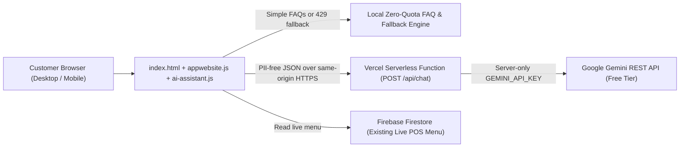

# Solution Architecture — Gemini AI Customer Assistant (Hungry Birds Website)

- **Status:** Proposed (Phase 1 Gate — Awaiting Owner Approval)
- **Date:** 2026-11-25
- **Source Requirements:** [docs/PRD.md](./PRD.md)
- **Stack Summary:** Extend the existing vanilla HTML/ES-Module + Tailwind CSS + Vercel static stack with a zero-dependency CommonJS Vercel Serverless Function (`api/chat.js`) calling the Gemini REST API (`generativelanguage.googleapis.com`), paired with a local zero-quota FAQ & menu fallback module (`ai-assistant.js`). Zero new npm dependencies, zero Firestore schema/rules changes, **\$0/month** hosting.

---

## 1. System Context


---

## 2. Components & Responsibilities
| Component | Path | Responsibility & Boundary |
|---|---|---|
| **Chat UI & Local Engine** | `ai-assistant.js` (ESM) | Renders the bottom-left `#aiChatFab` + slide-up `#aiChatDrawer` dialog; handles starter chips, `3s` send cooldown, `tryLocalFaqAnswer()` (`0` API calls), `buildSanitizedAiPayload()` (strips images & PII), `buildLocalMenuFallback()` (budget/craving matcher on `429`/`503`/offline), and safe `escapeHTML` + `data-action` rendering. |
| **Storefront Integration Seam** | `appwebsite.js`, `index.html`, `src/tailwind.css` | Injects read-only getters (`getMenuItems`, `getCategories`, `getCart`, `getOrderType`) and action callbacks (`addToCart`, `openTrackOrder`, `openCart`) into `initAiAssistant(...)`. Keeps `appwebsite.js` decoupled from chat logic. |
| **Serverless Proxy** | `api/chat.js` (CJS) | Vercel HTTP entry point for `POST /api/chat`. Enforces HTTP method (`POST`), same-origin check, JSON body size/shape validation, per-IP rate limit, and returns structured JSON. |
| **Server Core Logic** | `api/_lib/gemini-assistant.js` (CJS) | Private helper module (underscore prefix prevents Vercel from exposing it as a route): `checkRateLimit`, `isAllowedOrigin`, `validateAndSanitizeInput`, `buildGeminiRequestBody`, `callGeminiWithFallback`, `parseAndValidateModelOutput`. Unit-tested in `tests/qa.test.mjs` without network calls. |
| **Edge Headers & Offline Shell** | `vercel.json`, `sw.js`, `sw-register.js` | `vercel.json` sets `Cache-Control: no-store` on `/api/chat` and `no-cache` on `/ai-assistant.js`; `sw.js` (`v7`) skips `/api/*` and precaches `/ai-assistant.js`. |

---

## 3. Data Model
- **Firestore / POS Impact:** **None.** Zero new collections, zero changes to `firestore.rules`, `storage.rules`, or `hungrybirdspos`.
- **In-Memory Client Session State (`ai-assistant.js`):**
  - `messages`: array of `{ role: "user" | "assistant", text: string, recommendedItemIds: string[], actions: string[], source: "local" | "gemini" | "fallback" }` (cleared on page reload or "Clear" click; never persisted to `localStorage` or Firestore).
  - `lastSentAt`: timestamp enforcing a `3,000 ms` cooldown between sends.
- **In-Memory Server Rate-Limit Map (`api/_lib/gemini-assistant.js`):**
  - `Map<string, { minuteHits: number[], hourHits: number[] }>` capped at `1,000` IP entries (oldest evicted when full) to guarantee bounded memory.

---

## 4. API Contract — `POST /api/chat`
- **Headers:** `Content-Type: application/json`; same-origin `Origin` header validated against `Host` when present.
- **Request Body (strictly PII-free):**
```json
{
  "message": "1000 mein 2 burgers suggest karo",
  "history": [
    { "role": "user", "text": "hi" },
    { "role": "model", "text": "Hi! What are you craving today?" }
  ],
  "menu": [
    { "id": "item_1", "name": "Zinger Burger", "price": 450, "category": "Fast Food" }
  ],
  "cart": {
    "items": [{ "id": "item_1", "name": "Zinger Burger", "price": 450, "qty": 1 }],
    "subtotal": 450
  },
  "orderType": "DELIVERY"
}
```
- **Input Limits (enforced server-side):**
  - `message`: required trimmed string, `1..500` chars.
  - `history`: optional array, max `6` turns, each `role` in `["user", "model"]`, `text` max `500` chars.
  - `menu`: required array, `1..150` items, each sanitized to `{ id: string(<=80), name: string(<=120), price: finite number >= 0, category: string(<=60) }` (any `img`/base64/extra keys dropped).
  - `cart`: optional `{ items: <= 50 items, subtotal: number >= 0 }`; `orderType`: `"DELIVERY" | "TAKEAWAY"`.
  - Unknown top-level or nested keys (including `email`, `phone`, `address`, `uid`, `customerUid`, `orderId`) are stripped and never forwarded to Gemini.
- **Success Response (`200 OK`):**
```json
{
  "reply": "Aap Rs. 900 mein 2 Zinger Burgers le sakte hain! Delivery minimum Rs. 500 bhi easily cover ho jayega.",
  "recommendedItemIds": ["item_1"],
  "actions": ["OPEN_CART"],
  "model": "gemini-3.5-flash-lite",
  "source": "gemini"
}
```
  - `recommendedItemIds`: deduplicated array of `0..3` IDs verified to exist in the request's `menu` list.
  - `actions`: deduplicated array of valid enum values from `["TRACK_ORDER", "OPEN_CART", "WHATSAPP"]`.
- **Error Responses (JSON, triggering seamless local fallback when `fallback: true`):**
  - `400`: `{ "error": "INVALID_REQUEST", "message": "...", "fallback": false }`
  - `403`: `{ "error": "FORBIDDEN_ORIGIN", "message": "Cross-origin requests are not allowed.", "fallback": false }`
  - `405`: `{ "error": "METHOD_NOT_ALLOWED", "message": "Use POST.", "fallback": false }`
  - `429`: `{ "error": "RATE_LIMITED", "message": "Too many requests.", "retryAfterSeconds": 30, "fallback": true }`
  - `503`: `{ "error": "AI_NOT_CONFIGURED", "message": "Gemini API key not configured.", "fallback": true }`
  - `502`: `{ "error": "UPSTREAM_UNAVAILABLE", "message": "AI service temporarily busy.", "fallback": true }`

---

## 5. AuthN / AuthZ & Abuse Protection
- **Access:** Open to guests and signed-in customers (`US-AI-5`).
- **Server-side controls (in `api/chat.js`):**
  1. Same-origin enforcement (`Origin` hostname must match request `Host` / `x-forwarded-host`, allowing `localhost`/`127.0.0.1` in local dev).
  2. Per-IP sliding-window rate limit: **`12` requests / 60s** and **`60` requests / 3600s**.
  3. Strict payload size & field validation (rejects oversized bodies `> 32 KB`).
- **Client-side controls (in `ai-assistant.js`):**
  1. Zero-quota local FAQ interception before calling `/api/chat`.
  2. `3s` send cooldown + disabled button during in-flight request + `maxlength="500"`.

---

## 6. Cross-Cutting Concerns
- **Configuration & Secrets:**
  - `GEMINI_API_KEY` (required for live Gemini responses; stored only in Vercel Environment Variables; empty placeholder in `.env.example`).
  - `GEMINI_MODEL` (optional override; defaults to ordered free-tier fallback chain `["gemini-3.5-flash-lite", "gemini-2.5-flash-lite", "gemini-3.5-flash", "gemini-2.5-flash"]`).
- **Upstream Resilience:** Each upstream Gemini request uses `AbortSignal.timeout(6500)` within an overall `8.5s` server deadline (safely below Vercel Hobby's 10s cap). On `404` (retired/unavailable model) or `429` (per-model quota), `callGeminiWithFallback` tries the next model in the chain once; if all fail, returns `429` or `502` with `fallback: true` so the browser answers locally in `< 100 ms`.
- **Logging:** Log only error codes/model names (`console.warn("Gemini upstream status:", model, status)`); never log customer prompt text or API keys.
- **Caching & Service Worker:** `vercel.json` sets `Cache-Control: no-store` on `/api/chat`; `sw.js` (`v7`) returns early for `url.pathname.startsWith('/api/')`.

---

## 7. Security Notes
- **Trust Boundaries:** Browser → `/api/chat` (untrusted input, validated & rate-limited); `/api/chat` → Gemini API (trusted secret `GEMINI_API_KEY` passed via `x-goog-api-key` header rather than URL query string so keys never leak in proxy logs); Gemini Output → Browser (untrusted LLM output, parsed as strict JSON, allowlist-filtered for item IDs & actions, and rendered exclusively through `escapeHTML` + `data-action` delegation).
- **XSS / Injection:** Zero `innerHTML` interpolation of unescaped AI strings; zero Markdown-to-HTML parser; zero inline `onclick`.
- **Hallucination / Price Integrity:** UI never uses prices mentioned by Gemini for cart mutations — clicking **Add to Cart** calls existing `addToCart(validMenuItemId)` using the real live Firestore `menuItems` array.
- **CSP Compatibility:** Existing `connect-src 'self'` in `vercel.json` already allows same-origin `POST /api/chat` with zero CSP relaxation.

---

## 8. Scalability & Failure Modes
| Failure Mode | Trigger | Behavior |
|---|---|---|
| `GEMINI_API_KEY` missing | Before owner adds key in Vercel | `/api/chat` returns `503 { fallback: true }`; UI seamlessly answers with `buildLocalMenuFallback()` (real menu suggestions + Add to Cart). |
| Free-tier RPM/RPD limit hit | Dinner rush / burst traffic | `/api/chat` tries next model in fallback chain, then returns `429 { fallback: true }`; UI seamlessly answers via `buildLocalMenuFallback()`. |
| Model alias deprecated (`404`) | Google retires a model ID | `callGeminiWithFallback()` skips `404` model to next alias; owner can also pin any newer ID via `GEMINI_MODEL` env var without code changes. |
| Menu not loaded yet / offline | Slow ISP on page open | Local FAQ still works; menu-dependent prompts politely suggest retrying menu load or contacting WhatsApp `0325-7867774`. |

---

## 9. Repo Structure & Conventions
```
api/
  chat.js                      Vercel Serverless Function (POST /api/chat, CommonJS)
  _lib/gemini-assistant.js     Private testable validation, rate-limit & Gemini REST client (CJS)
ai-assistant.js                Client ES module: chat drawer UI, local FAQ router & menu fallback
appwebsite.js                  Wires initAiAssistant(...) with menu/cart getters & callbacks
index.html                     Adds #aiChatFab (bottom-left) and #aiChatDrawer (role="dialog")
src/tailwind.css               Chat drawer transitions & message bubble utilities -> styles.css
sw.js / sw-register.js         v7 cache bump, /api/ bypass, precache /ai-assistant.js
vercel.json                    Literal no-store for /api/chat, no-cache for /ai-assistant.js
.env.example                   Adds GEMINI_API_KEY= and GEMINI_MODEL= placeholders
tests/qa.test.mjs              Adds unit + handler + UI contract tests (TC-044–TC-049)
```

---

## 10. Architectural Decisions
- [ADR-0001: Firebase Security Hardening & Non-PII Guest Tracking Projection](./adr/0001-firebase-security-hardening.md)
- [ADR-0002: Zero-Cost Gemini AI Customer Assistant Architecture](./adr/0002-gemini-ai-assistant-architecture.md)
